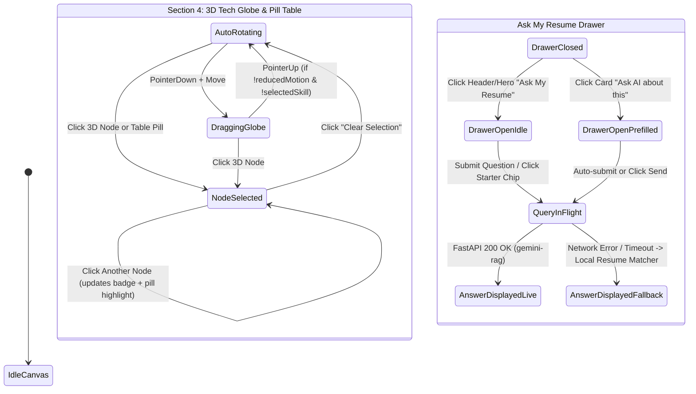

# Phase 1 Data Model: Neo-Brutalist Single-Page Portfolio Application

**Feature Branch**: `001-single-page-portfolio`  
**Date**: 2026-11-14  
**Source of Truth**: `docs/resume.md` & `specs/001-single-page-portfolio/spec.md`

---

## 1. Domain Entities (Frontend TypeScript 5.8 & Canonical Resume Dataset)

All frontend portfolio sections and the local fallback RAG engine read from a strongly-typed, immutable TypeScript data module (`frontend/src/data/resume.ts`) strictly derived from `docs/resume.md`.

### 1.1 `ProfileSummary`
Represents Section 1 (Header & Hero), Section 3 (About Narrative), and Section 7 (Contact Banner & Footer) identity metadata.

| Field | Type | Constraints / Exact Value (`docs/resume.md`) |
| :--- | :--- | :--- |
| `fullName` | `string` | `"Allen James Laxamana"` |
| `headline` | `string` | `"Junior .NET / Full-Stack Developer"` |
| `coreStackSubheadline` | `string` | `"C#, ASP.NET Core, Blazor, PostgreSQL, REST APIs"` |
| `heroBadge` | `string` | `"Full-Stack & AI"` |
| `summaryBio` | `string` | Factual summary from lines 7–11 of `docs/resume.md` (BPSU 2026 CS graduate, built `SuhayCore` in C#/.NET 10/Blazor/PostgreSQL now in staff UAT, built Python/FastAPI backend & dashboard + RAG AI in systems internship). |
| `aboutNarrative` | `string[]` | Factual multi-paragraph narrative detailing the transition from BPSU Computer Science studies in Balanga, Bataan to building `SuhayCore` (.NET 10) and `DAN` (FastAPI/Gemini RAG) across Bataan and Makati. |
| `profilePhotoPath` | `string` | `"/images/others/my-photo.png"` |
| `email` | `string` | `"allenjames.laxamana@gmail.com"` |
| `phone` | `string` | `"+63 945-322-7669"` |
| `location` | `string` | `"Balanga, Bataan"` |
| `linkedInUrl` | `string` | `"https://www.linkedin.com/in/allen-james-laxamana-0673473a5/"` |
| `githubUrl` | `string` | `process.env.NEXT_PUBLIC_GITHUB_URL ?? "https://github.com/xZept"` |

---

### 1.2 `ExperienceEntry`
Represents each card in Section 2 (Experience & Project Showcase) and its associated Case Study modal payload.

| Field | Type | Constraints / Validation Rules |
| :--- | :--- | :--- |
| `id` | `"suhaycore" \| "dan" \| "fitquest"` | Unique slug identifier |
| `title` | `string` | Project / deliverable name (`"SuhayCore"`, `"DAN — Enterprise RAG AI & Monitoring Backend"`, `"FitQuest"`) |
| `role` | `string` | Role title (`"Full-Stack Web Developer Intern (Project-Based)"`, `"Systems Developer Intern"`, `"Android Developer (Academic / Capstone Project)"`) |
| `organization` | `string` | `"Orani Suhay Foundation, Inc."`, `"DACON Corporation"`, or `"Bataan Peninsula State University (Project)"` |
| `dateRange` | `string` | `"March 2026 - Present"`, `"February 2026 – March 2026"`, `"2025"` |
| `location` | `string` | `"Remote"`, `"Makati City, Metro Manila"`, `"Balanga, Bataan"` |
| `statusBadge` | `"In UAT" \| "Shipped" \| "Android"` | Rendered in top-left/right neo-brutalist badge pill |
| `previewImage` | `string` | `"/images/projects/suhaycore.png"`, `"/images/projects/dan.png"`, `"/images/projects/fitquest.gif"` |
| `isAnimatedGif` | `boolean` | `true` for `fitquest.gif` (requires `unoptimized` in Next.js `<Image>`) |
| `impactBullets` | `string[]` | Exact factual bullets from `docs/resume.md` (5 for SuhayCore, 4 for DAN, 2 for FitQuest) |
| `techTags` | `string[]` | Exact tech tags per FR-005 |
| `caseStudy` | `CaseStudyDetail` | Structured breakdown (`problemSummary`, `architectureHighlights`, `securityAndData`, `deliveryStatus`) strictly derived from `docs/resume.md` bullets for the **"View Case Study"** modal |
| `askAiPrompt` | `string` | Pre-filled starter query when clicking **"Ask AI about this"** (e.g., `"Tell me about Allen's architecture and role on SuhayCore at Orani Suhay Foundation."`) |

---

### 1.3 `MilestoneItem`
Represents each chronological entry in the Section 3 (About) right-hand Timeline card (FR-006).

| Field | Type | Exact Entries (4 total) |
| :--- | :--- | :--- |
| `id` | `string` | `"milestone-fitquest-2025"`, `"milestone-dacon-feb-2026"`, `"milestone-suhaycore-mar-2026"`, `"milestone-bpsu-grad-2026"` |
| `dateLabel` | `string` | `"2025"`, `"Feb 2026"`, `"Mar 2026"`, `"2026"` |
| `title` | `string` | `"FitQuest"`, `"DACON Systems Internship"`, `"SuhayCore .NET 10 Lead"`, `"BS Computer Science Grad"` |
| `description` | `string` | Factual 1–2 sentence milestone summary grounded in `docs/resume.md` |

---

### 1.4 `SkillNode` & `SkillCategoryGroup`
Represents the 22 interactive 3D Tech Globe nodes and the 4 rows of the Categorized Pill Table in Section 4 (FR-007 & FR-008).

#### `SkillCategoryName` Enum
- `"Languages & Core"`
- `"Frameworks & Web"`
- `"Data & Infrastructure"`
- `"Engineering Practices"`

#### `SkillNode` (22 Interactive 3D Globe Nodes)
| Field | Type | Validation Rules |
| :--- | :--- | :--- |
| `id` | `string` | URL-safe slug (e.g., `"csharp"`, `"dotnet-core"`, `"blazor-mudblazor"`, `"postgresql"`) |
| `label` | `string` | Short 3D node label (`C#`, `SQL`, `JavaScript`, `HTML/CSS`, `Python`, `Java`, `Kotlin`, `ASP.NET Core`, `Blazor / MudBlazor`, `FastAPI`, `Jinja2`, `REST APIs`, `Android / Room`, `PostgreSQL`, `Supabase`, `SQLite`, `pg_cron`, `Render`, `Git`, `Linux`, `RBAC`, `SDLC`) |
| `pillMatchLabels` | `string[]` | Exact pill text(s) in the Categorized Pill Table that highlight when this 3D node is selected (e.g., `Blazor / MudBlazor` <-> `Blazor (MudBlazor)`, `RBAC` <-> `Role-Based Access Control (RBAC)`) |
| `category` | `SkillCategoryName` | One of the 4 resume categories |
| `resumeUsageSummary` | `string` | Factual summary of where Allen used this skill in `docs/resume.md` (e.g., `"Used in SuhayCore (Orani Suhay Foundation) to build the .NET 10 full-stack scholarship & activity tracking web application."`) |
| `relatedExperienceIds` | `Array<"suhaycore" \| "dan" \| "fitquest">` | Links skill node to its Experience cards |

#### `SkillCategoryGroup` (4 Categorized Pill Table Rows)
| Category | Exact Pill Items (`docs/resume.md` lines 49–51) |
| :--- | :--- |
| **Languages & Core** | `C#`, `SQL`, `JavaScript`, `HTML/CSS`, `Python`, `Java`, `Kotlin` |
| **Frameworks & Web** | `ASP.NET Core`, `Blazor (MudBlazor)`, `FastAPI`, `Jinja2`, `REST APIs`, `Android (Kotlin, Room)` |
| **Data & Infrastructure** | `PostgreSQL`, `Supabase`, `SQLite`, `pg_cron`, `Render`, `Git`, `Linux` |
| **Engineering Practices** | `SDLC`, `Modified Waterfall`, `Role-Based Access Control (RBAC)`, `UAT`, `Requirement Analysis`, `Relational DB Design` |

---

### 1.5 `EducationRecord`
Represents the Section 5 Education card (FR-009).

| Field | Type | Exact Value (`docs/resume.md`) |
| :--- | :--- | :--- |
| `institution` | `string` | `"Bataan Peninsula State University (BPSU)"` |
| `degree` | `string` | `"Bachelor of Science in Computer Science"` |
| `period` | `string` | `"2022 – 2026"` |
| `location` | `string` | `"Balanga, Bataan"` |
| `logoPath` | `string` | `"/images/others/bataan-peninsula-state-university.png"` |

---

### 1.6 `CertificationRecord`
Represents each of the 5 cards in Section 6 (FR-010 & Clarification #4).

| ID | Title | Issuer Badge | Year | Primary Logo | Co-Brand Logo |
| :--- | :--- | :--- | :--- | :--- | :--- |
| `it-specialist-js` | `IT Specialist in JavaScript` | `Certiport / Pearson VUE` | `2026` | `/images/certifications/pearson.png` | `/images/certifications/microsoft.png` |
| `it-specialist-cybersecurity` | `IT Specialist in Cybersecurity` | `Certiport / Pearson VUE` | `2025` | `/images/certifications/pearson.png` | `/images/certifications/microsoft.png` |
| `it-specialist-html-css` | `IT Specialist in HTML & CSS` | `Certiport / Pearson VUE` | `2024` | `/images/certifications/pearson.png` | `/images/certifications/microsoft.png` |
| `it-specialist-software-dev` | `IT Specialist in Software Development` | `Certiport / Pearson VUE` | `2024` | `/images/certifications/pearson.png` | `/images/certifications/microsoft.png` |
| `cisco-cyber-threat-mgmt` | `Cisco Cyber Threat Management` | `Cisco` | `2025` | `/images/certifications/cisco.png` | `null` |

---

## 2. Backend Pydantic 2.14.3 & PostgreSQL 18 (`pgvector`) Entities

### 2.1 Pydantic 2.14.3 Request & Response Models (`backend/app/schemas/ask_resume.py`)

#### `AskResumeRequest`
- `question`: `str` — `Field(..., min_length=2, max_length=500, description="Visitor question about Allen James Laxamana's resume")` (stripped of leading/trailing whitespace via Pydantic `@field_validator`; rejects empty/whitespace-only strings).
- `context_project_id`: `Literal["suhaycore", "dan", "fitquest"] | None = None` — Optional project scope passed when invoked from a Section 2 card's **"Ask AI about this"** button.

#### `ResumeCitation`
- `section`: `Literal["Summary", "Work Experience - Orani Suhay Foundation", "Work Experience - DACON Corporation", "Projects - FitQuest", "Education", "Certifications", "Skills"]`
- `snippet`: `str` — Grounded excerpt from `docs/resume.md`.

#### `AskResumeResponse`
- `answer`: `str` — Strictly grounded response answering the visitor's question.
- `citations`: `list[ResumeCitation]` — At least 1 source citation from `docs/resume.md`.
- `mode`: `Literal["gemini-rag", "local-fallback"]` — Indicates whether the answer was synthesized by live Gemini + `pgvector` RAG or the deterministic fallback engine.
- `model_used`: `str` — e.g. `"gemini-3.5-flash-lite"` or `"deterministic-resume-grounding"`.
- `suggested_followups`: `list[str]` — Up to 3 follow-up starter questions.

---

### 2.2 PostgreSQL 18 (`Supabase`) Schema (`supabase/migrations/001_resume_rag.sql`)

1. **`resume_chunks` Table (`pgvector`)**:
   - `id`: `UUID PRIMARY KEY DEFAULT gen_random_uuid()`
   - `section`: `TEXT NOT NULL`
   - `content`: `TEXT NOT NULL`
   - `metadata`: `JSONB NOT NULL DEFAULT '{}'::jsonb`
   - `embedding`: ` VECTOR(768)` (indexed via `HNSW` cosine distance for `gemini-embedding-2` lookups)
   - `created_at`: `TIMESTAMPTZ NOT NULL DEFAULT now()`

2. **`resume_query_logs` Table + `pg_cron` 30-Day Archival**:
   - `id`: `UUID PRIMARY KEY DEFAULT gen_random_uuid()`
   - `question`: `TEXT NOT NULL`
   - `context_project_id`: `TEXT NULL`
   - `mode`: `TEXT NOT NULL`
   - `latency_ms`: `INTEGER NOT NULL`
   - `created_at`: `TIMESTAMPTZ NOT NULL DEFAULT now()`
   - **Scheduled `pg_cron` Job**: Runs daily at `03:00 UTC` (`SELECT cron.schedule('purge-old-resume-query-logs', '0 3 * * *', $$DELETE FROM public.resume_query_logs WHERE created_at < now() - INTERVAL '30 days'$$);`).

---

## 3. UI State Transitions

