# Phase 1 Data Model: Ask My Resume AI Assistant Drawer & Supabase `pgvector` Schema

**Feature Branch**: `002-ask-my-resume`  
**Date**: 2026-11-14  
**Source of Truth**: `docs/resume.md`, `specs/002-ask-my-resume/spec.md`, and Supabase MCP Inspection (`iixpswqqkxfghbujdnha`)

---

## 1. Supabase PostgreSQL (`pgvector`) Database Entities

### 1.1 `public.resume_chunks` Table
Stores factual, fine-grained resume segments from `docs/resume.md` alongside their 768-dimensional Google `gemini-embedding-2` vectors and clickable portfolio citation routing metadata.

| Column | PostgreSQL Type | Constraints & Defaults | Description |
| :--- | :--- | :--- | :--- |
| `id` | `UUID` | `PRIMARY KEY DEFAULT gen_random_uuid()` | Unique row identifier |
| `chunk_key` | `TEXT` | `NOT NULL UNIQUE` | Deterministic slug (e.g., `'work-suhaycore-arch'`, `'work-dacon-rag'`) for idempotent `ON CONFLICT (chunk_key) DO UPDATE` seeding |
| `section` | `TEXT` | `NOT NULL` | Canonical resume section name (`'Work Experience - Orani Suhay Foundation'`, `'Work Experience - DACON Corporation'`, `'Projects - FitQuest'`, `'Education'`, `'Certifications'`, `'Skills'`, `'Summary'`) |
| `badge_label` | `TEXT` | `NOT NULL CHECK (badge_label IN ('[Work: Orani Suhay Foundation]', '[Work: DACON Corp]', '[Project: FitQuest]', '[Education: BPSU]', '[Certifications]'))` | Exact clickable inline citation badge text required by `FR-008` |
| `target_section_id` | `TEXT` | `NOT NULL CHECK (target_section_id IN ('experience', 'about', 'skills', 'education', 'certifications', 'contact'))` | Background portfolio section ID for smooth scroll (`FR-009`) |
| `target_card_id` | `TEXT` | `NOT NULL` | Target DOM card element ID to scroll to and highlight (`'card-work-suhay'`, `'card-work-dacon'`, `'card-project-fitquest'`, `'card-education-bpsu'`, `'card-certifications'`) |
| `project_id` | `TEXT` | `NULL CHECK (project_id IN ('suhaycore', 'dan', 'fitquest') OR project_id IS NULL)` | Optional project scope filter for card-initiated queries |
| `content` | `TEXT` | `NOT NULL CHECK (char_length(btrim(content)) > 0)` | Factual resume excerpt strictly grounded in `docs/resume.md` |
| `metadata` | `JSONB` | `NOT NULL DEFAULT '{}'::jsonb` | Structured metadata (`role`, `organization`, `date_range`, `location`, `tech_tags`, `keywords`) |
| `embedding` | `extensions.vector(768)` | `NOT NULL` | 768-dimensional embedding generated by `gemini-embedding-2` |
| `created_at` | `TIMESTAMPTZ` | `NOT NULL DEFAULT now()` | Row creation timestamp (UTC) |
| `updated_at` | `TIMESTAMPTZ` | `NOT NULL DEFAULT now()` | Last seed/update timestamp (UTC) |

#### Indexes on `public.resume_chunks`
1. **Primary Vector Index (HNSW Cosine Distance)**:
   - Name: `idx_resume_chunks_embedding_hnsw`
   - Definition: `USING hnsw (embedding extensions.vector_cosine_ops) WITH (m = 16, ef_construction = 64)`
   - Purpose: Accelerates `embedding <=> query_embedding` nearest-neighbor queries with high recall (`> 0.99`), zero empty-table build degradation, and `pgvector 0.8.2` iterative filter scan support.
2. **Alternative Reference Vector Index (IVFFlat Cosine Distance — Documented for High-Scale Tuning)**:
   - Name: `idx_resume_chunks_embedding_ivfflat` *(mutually exclusive with HNSW at runtime; documented in `contracts/database-contracts.md`)*
   - Definition: `USING ivfflat (embedding extensions.vector_cosine_ops) WITH (lists = 10)`
3. **Supporting Filter Indexes**:
   - `idx_resume_chunks_project_id`: `ON public.resume_chunks (project_id) WHERE project_id IS NOT NULL` (partial B-tree index for scoped project queries).
   - `idx_resume_chunks_metadata_gin`: `ON public.resume_chunks USING gin (metadata)` (GIN index for `metadata @> filter_metadata` containment).

#### Row-Level Security (RLS) Policies on `public.resume_chunks`
- `ALTER TABLE public.resume_chunks ENABLE ROW LEVEL SECURITY;`
- Policy `"resume_chunks_public_read"`: `FOR SELECT TO anon, authenticated USING (true)` — allows read-only vector similarity lookups while blocking public `INSERT`/`UPDATE`/`DELETE`.

---

### 1.2 `public.match_resume_chunks` RPC Function
Encapsulates cosine similarity ranking, similarity threshold gating, and inline `project_id` / `JSONB` metadata filtering.

#### Function Signature & Return Table
| Parameter / Return Column | Direction | Type | Default / Description |
| :--- | :--- | :--- | :--- |
| `query_embedding` | `IN` | `extensions.vector(768)` | Required 768-dim query vector from `gemini-embedding-2` |
| `match_threshold` | `IN` | `float` | `DEFAULT 0.35` — Minimum cosine similarity (`1 - (embedding <=> query_embedding)`) |
| `match_count` | `IN` | `int` | `DEFAULT 5` — Clamped internally via `LEAST(GREATEST(match_count, 1), 20)` |
| `filter_project_id` | `IN` | `text` | `DEFAULT NULL` — Optional `'suhaycore' \| 'dan' \| 'fitquest'` filter |
| `filter_metadata` | `IN` | `jsonb` | `DEFAULT '{}'::jsonb` — Optional JSONB `@>` containment filter |
| `id` | `OUT` | `uuid` | Matched chunk primary key |
| `chunk_key` | `OUT` | `text` | Deterministic chunk slug |
| `section` | `OUT` | `text` | Canonical resume section |
| `badge_label` | `OUT` | `text` | Inline citation badge (`[Work: Orani Suhay Foundation]`, etc.) |
| `target_section_id` | `OUT` | `text` | Target portfolio section ID |
| `target_card_id` | `OUT` | `text` | Target portfolio card ID |
| `project_id` | `OUT` | `text` | Project slug (`suhaycore`, `dan`, `fitquest`, or `NULL`) |
| `content` | `OUT` | `text` | Grounded resume text |
| `metadata` | `OUT` | `jsonb` | Chunk metadata |
| `similarity` | `OUT` | `float` | Cosine similarity score in `[0.0, 1.0]` (`1 - (rc.embedding <=> query_embedding)`) |

---

### 1.3 `public.resume_query_logs` Table (Telemetry & `pg_cron` Archival)
Records anonymized query latency and mode telemetry with a daily `pg_cron` 30-day retention purge (`purge-old-resume-query-logs`).
- RLS enabled (`ALTER TABLE public.resume_query_logs ENABLE ROW LEVEL SECURITY;`) with zero `anon`/`authenticated` policies (accessible only via backend service/database connection).

---

## 2. Canonical Citation Badge Routing Matrix (`FR-008` & `FR-009`)

Every factual claim in an assistant response attaches one or more of the five canonical `SourceCitationBadge` entities:

| `badge_label` | `section` | `target_section_id` | `target_card_id` | `project_id` | Resume Scope (`docs/resume.md`) |
| :--- | :--- | :--- | :--- | :--- | :--- |
| `[Work: Orani Suhay Foundation]` | `Work Experience - Orani Suhay Foundation` | `experience` | `card-work-suhay` | `suhaycore` | SuhayCore `.NET 10`, `C#`, `Blazor (MudBlazor)`, `PostgreSQL`, `RBAC`, `Render` staging, staff `UAT`, scholarship & activity workflows |
| `[Work: DACON Corp]` | `Work Experience - DACON Corporation` | `experience` | `card-work-dacon` | `dan` | `Python`/`FastAPI` backend on `Render`, `Supabase` (`PostgreSQL`) + `pg_cron` 30-day archival, `HTML/CSS/JS/Jinja2` dashboard, `DAN` RAG AI chatbot (`Google Gemini`, `LangChain`, `Botpress`) |
| `[Project: FitQuest]` | `Projects - FitQuest` | `experience` | `card-project-fitquest` | `fitquest` | `Android` app (`2025`), `FoodData Central REST API`, `Kotlin` structured parsing, `Room Database` (`SQLite`) offline persistence |
| `[Education: BPSU]` | `Education` | `education` | `card-education-bpsu` | `null` | `Bataan Peninsula State University (BPSU)` — BS Computer Science (`2022 – 2026`, `Balanga, Bataan`) |
| `[Certifications]` | `Certifications` | `certifications` | `card-certifications` | `null` | `Certiport (Pearson VUE)` IT Specialist in JavaScript (`2026`), Cybersecurity (`2025`), HTML & CSS (`2024`), Software Development (`2024`); `Cisco` Cyber Threat Management (`2025`) |

---

## 3. Frontend & Backend Application Entities

### 3.1 `ChatSessionState` (Frontend `useAskResumeSession`)
| Field | Type | Constraints / Rules |
| :--- | :--- | :--- |
| `maxMessages` | `15` | Constant per-session cap (`FR-011`, `FR-012`) |
| `usedMessages` | `number` | Integer `0..15` persisted in `sessionStorage["allen_ask_resume_session_v1"]` |
| `remainingMessages` | `number` | Derived `Math.max(0, 15 - usedMessages)`; displayed as `${remainingMessages} / 15 messages remaining` |
| `isCapReached` | `boolean` | `usedMessages >= 15`; locks text input, send button, and starter chips, and renders the `#38BDF8` cap banner |
| `messages` | `ChatMessage[]` | Active thread; cleared to `[]` on **"Clear Chat"** without resetting `usedMessages` |
| `isStreaming` | `boolean` | `true` while an assistant turn is actively streaming tokens; blocks concurrent submissions |

### 3.2 `ChatMessage` (Frontend Drawer Thread Item)
| Field | Type | Description |
| :--- | :--- | :--- |
| `id` | `string` | Unique turn identifier |
| `role` | `"user" \| "assistant"` | Bubble alignment and styling selector |
| `content` | `string` | User prompt text or incrementally streamed assistant text |
| `status` | `"streaming" \| "complete" \| "error"` | Controls typing indicator (`streaming`), citation badges (`complete`), or inline Retry/mailto error card (`error`) |
| `citations` | `SourceCitationBadge[]` | Clickable inline source badges attached to factual claims |
| `isOffTopic` | `boolean` | `true` when guardrails declined an off-topic/private query (`FR-010`) |
| `failedPrompt` | `string \| undefined` | Preserved when `status === "error"` so clicking **"Retry"** re-submits without double-charging quota |

---

## 4. State Transitions (`AskResumeDrawer` & Session Quota)

```mermaid
stateDiagram-v2
    [*] --> Closed

    state "Drawer Open" as OpenState {
        StarterChipsView: Starter Prompts View (3 Chips + Input)
        StreamingTurn: Assistant Streaming (Typing Indicator + Incremental Tokens)
        ThreadActive: Conversation Thread (Messages + Clickable Citation Badges)
        TurnError: Inline Error State ("Retry" + mailto link; quota NOT charged)
        SessionCapLocked: Session Cap Reached (0 / 15 remaining; Input Locked + #38BDF8 Banner)

        StarterChipsView --> StreamingTurn: Click Starter Chip or Submit Question (if remaining > 0)
        ThreadActive --> StreamingTurn: Submit Follow-up Question (if remaining > 0)
        StreamingTurn --> ThreadActive: Stream Complete (usedMessages += 1; if usedMessages < 15)
        StreamingTurn --> SessionCapLocked: Stream Complete (usedMessages == 15)
        StreamingTurn --> TurnError: Network / Mid-Stream Error (usedMessages unchanged)
        TurnError --> StreamingTurn: Click "Retry"
        ThreadActive --> StarterChipsView: Click "Clear Chat" (if usedMessages < 15; preserves usedMessages)
        SessionCapLocked --> SessionCapLocked: Click "Clear Chat" (clears thread, keeps Input Locked + Cap Banner)
    }

    Closed --> StarterChipsView: Click Floating Trigger / Header / Hero Button (usedMessages < 15)
    Closed --> SessionCapLocked: Click Trigger (when usedMessages == 15)
    OpenState --> Closed: Click Close (X) / Press Escape / Click Citation Badge on Mobile (<768px)
```

