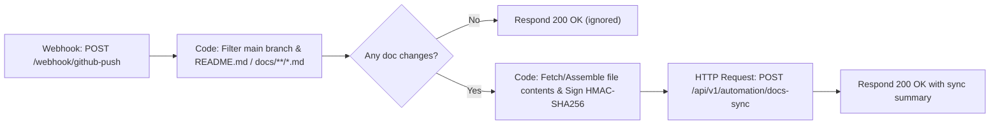
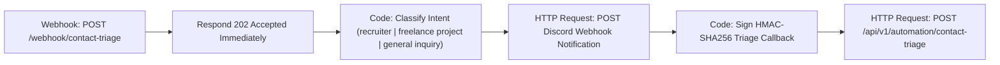
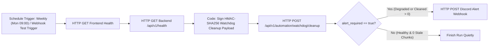

# n8n 2.47 Workflows Contract (`automation/n8n/`)

**Feature**: `006-n8n-automation-layer`  
**Runtime**: `n8nio/n8n:2.47.0` (`automation/n8n/docker-compose.yml`)  
**Export Location**: `automation/n8n/workflows/`

---

## 1. Environment Variables (`automation/n8n/.env.example` & `docker-compose.yml`)

| Variable | Description | Example / Default |
| :--- | :--- | :--- |
| `N8N_HOST` | Hostname for n8n instance | `localhost` |
| `N8N_PORT` | HTTP port for n8n | `5678` |
| `N8N_PROTOCOL` | Protocol (`http` or `https`) | `http` |
| `GENERIC_TIMEZONE` | Schedule trigger timezone | `Asia/Manila` |
| `BACKEND_API_BASE_URL` | Base URL of the FastAPI backend reachable from n8n container | `http://host.docker.internal:8000` |
| `FRONTEND_PUBLIC_URL` | Public or local Next.js frontend URL probed by Watchdog | `http://host.docker.internal:3000` |
| `AUTOMATION_WEBHOOK_SECRET` | Shared secret used to sign `X-Automation-Signature` (`HMAC-SHA256`) | `replace-with-32-byte-hex-secret` |
| `DISCORD_WEBHOOK_URL` | Discord incoming webhook URL for Contact Triage & Watchdog alerts | `https://discord.com/api/webhooks/...` |
| `GEMINI_API_KEY` | Optional Gemini API key for LLM-assisted triage in n8n (with deterministic fallback) | `AIza...` |
| `GITHUB_RAW_BASE_URL` | Base URL for fetching raw markdown files on `main` when payload omits inline content | `https://raw.githubusercontent.com/allenlaxamana/portfolio/main` |

---

## 2. Workflow 1: GitHub-to-RAG Sync (`automation/n8n/workflows/github-rag-sync.workflow.json`)

- **Trigger**: `n8n-nodes-base.webhook` (`POST /webhook/github-push`, `responseMode: "responseNode"`).
- **Filtering Logic**:
  - Checks `body.ref === "refs/heads/main"`. If not `main`, returns `{ "status": "ignored", "reason": "non-main branch" }`.
  - Iterates `body.commits[]` in chronological order, tracking the net state (`upsert` vs `remove`) of every file path matching `^(README\.md|docs\/.+\.md)$`.
  - If both `upserted_files` and `removed_files` are empty, returns `{ "status": "ignored", "reason": "no documentation changes" }`.
- **HMAC Signing & Backend Callback**:
  - Computes `timestamp = Math.floor(Date.now() / 1000).toString()`.
  - Serializes `DocsSyncCallbackRequest` JSON body and computes `sha256=` + `HMAC_SHA256(AUTOMATION_WEBHOOK_SECRET, `${timestamp}.${rawBody}`)`.
  - Calls `POST ${BACKEND_API_BASE_URL}/api/v1/automation/docs-sync` with `X-Automation-Timestamp` and `X-Automation-Signature`.

---

## 3. Workflow 2: Contact Lead Triage (`automation/n8n/workflows/contact-lead-triage.workflow.json`)

- **Trigger**: `n8n-nodes-base.webhook` (`POST /webhook/contact-triage`).
- **Intent Classification Rules (`FR-006`)**:
  - Classifies into exactly one of:
    1. `"recruiter"`: mentions hiring, role, interview, recruiter, talent acquisition, full-time position, job opening, salary/compensation, or company recruiting.
    2. `"freelance project"`: mentions freelance, contract, project quote, MVP build, consulting, client project, budget, or timeline for a build.
    3. `"general inquiry"`: networking, questions, feedback, ambiguous/ultra-short messages (e.g., `"Hi, let's connect"`), or fallback when LLM/keyword signals are inconclusive.
- **Discord Notification Payload (`FR-007`)**:
  - Sends a formatted Discord message/embed to `DISCORD_WEBHOOK_URL` containing:
    - **Title**: `[Contact Lead: {INTENT_UPPER}] {name}`
    - **Fields**: `Name`, `Email`, `Intent Category`, `Subject`, `Summary`, and `Message Excerpt`.
- **Backend Callback**:
  - Signs and posts `ContactTriageCallbackRequest` to `POST ${BACKEND_API_BASE_URL}/api/v1/automation/contact-triage`.

---

## 4. Workflow 3: Scheduled Weekly Health & Index Watchdog (`automation/n8n/workflows/weekly-watchdog.workflow.json`)

- **Trigger**: `n8n-nodes-base.scheduleTrigger` (`0 9 * * 1` — weekly every Monday at 09:00 `Asia/Manila`) + optional test webhook `POST /webhook/watchdog-run` for on-demand verification.
- **Health Probes**:
  - Probes `GET ${FRONTEND_PUBLIC_URL}` and `GET ${BACKEND_API_BASE_URL}/api/v1/health` with `continueOnFail: true` and `timeout: 5000`.
- **Authenticated Cleanup & Evaluation**:
  - Signs and sends `WatchdogCleanupCallbackRequest` (`auto_clean: true`) to `POST ${BACKEND_API_BASE_URL}/api/v1/automation/watchdog/cleanup`.
- **Conditional Discord Alert (`FR-008`, `FR-009`)**:
  - Only dispatches a Discord webhook message to `DISCORD_WEBHOOK_URL` when `alert_required === true` (i.e., `frontend_healthy === false`, `backend_healthy === false`, or `stale_chunks_deleted > 0`).
