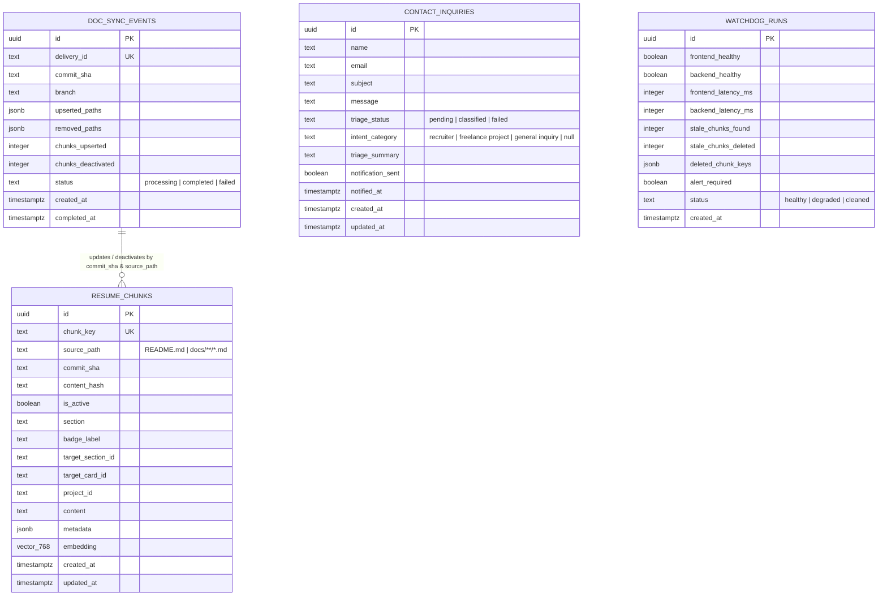

# Phase 1 Data Model: n8n Automation Layer for Asynchronous Background Workflows

**Feature**: `006-n8n-automation-layer`  
**Date**: 2026-11-16  
**Database Engine**: Supabase PostgreSQL (`pgvector` `0.8.2`, `pg_cron` `1.6.4`)  
**Migration File**: `apps/api/migrations/002_automation_layer.sql` (mirrored in `supabase/migrations/002_automation_layer.sql`)

---

## 1. Entity Relationship Diagram

---

## 2. PostgreSQL Tables & Schema Extensions

### 2.1 Extended Table: `public.resume_chunks` (Knowledge Base Document Chunk)
Extends the existing `public.resume_chunks` table created in `001_resume_chunks_and_rpc.sql` to track file-level lineage, content hashes, and active/stale status across `README.md` and `docs/**/*.md`.

| Column | Type | Nullable | Default | Constraints & Validation Rules |
| :--- | :--- | :--- | :--- | :--- |
| `id` | `UUID` | `NOT NULL` | `gen_random_uuid()` | Primary Key |
| `chunk_key` | `TEXT` | `NOT NULL` | — | `UNIQUE`, deterministic key per file + section (e.g., `work-suhaycore`, `readme::overview`) |
| `source_path` | `TEXT` | `NOT NULL` | `'docs/resume.md'` | `CHECK (source_path = 'README.md' OR source_path LIKE 'docs/%.md')` |
| `commit_sha` | `TEXT` | `NULL` | `'initial-seed'` | Git commit SHA (`7..64` hex/revision identifier) that last updated the chunk |
| `content_hash` | `TEXT` | `NOT NULL` | `''` | SHA-256 hex digest of normalized `content` for idempotent change detection |
| `is_active` | `BOOLEAN` | `NOT NULL` | `true` | `false` when the source file or section is deleted or superseded |
| `section` | `TEXT` | `NOT NULL` | — | Canonical resume/doc section title |
| `badge_label` | `TEXT` | `NOT NULL` | — | `CHECK` in canonical 5 citation badges |
| `target_section_id` | `TEXT` | `NOT NULL` | — | `CHECK` in `('experience', 'about', 'skills', 'education', 'certifications', 'contact')` |
| `target_card_id` | `TEXT` | `NOT NULL` | — | Portfolio DOM card target ID |
| `project_id` | `TEXT` | `NULL` | `NULL` | `CHECK (project_id IN ('suhaycore', 'dan', 'fitquest') OR project_id IS NULL)` |
| `content` | `TEXT` | `NOT NULL` | — | `CHECK (char_length(btrim(content)) > 0)` |
| `metadata` | `JSONB` | `NOT NULL` | `'{}'::jsonb` | Structured metadata (`source_path`, `commit_sha`, `tech_tags`, etc.) |
| `embedding` | `extensions.vector(768)` | `NOT NULL` | — | 768-dim `gemini-embedding-2` vector |
| `created_at` | `TIMESTAMPTZ` | `NOT NULL` | `now()` | Creation timestamp |
| `updated_at` | `TIMESTAMPTZ` | `NOT NULL` | `now()` | Last upsert timestamp |

**Indexes & RLS Updates on `public.resume_chunks`**:
- `idx_resume_chunks_source_path`: B-tree index on `(source_path)` for fast per-file sync and removal lookups.
- `idx_resume_chunks_stale`: Partial B-tree index on `(is_active, updated_at) WHERE is_active = false` for instant watchdog stale-chunk scans.
- `public.match_resume_chunks` RPC updated to filter `AND rc.is_active = true` so inactive/stale chunks are excluded from similarity search before cleanup runs.

---

### 2.2 New Table: `public.doc_sync_events` (Documentation Sync Event)
Tracks GitHub push webhook deliveries for `refs/heads/main` to guarantee idempotent processing (`FR-004`, `SC-002`).

| Column | Type | Nullable | Default | Constraints & Validation Rules |
| :--- | :--- | :--- | :--- | :--- |
| `id` | `UUID` | `NOT NULL` | `gen_random_uuid()` | Primary Key |
| `delivery_id` | `TEXT` | `NOT NULL` | — | `UNIQUE`, `CHECK (char_length(btrim(delivery_id)) > 0)` |
| `commit_sha` | `TEXT` | `NOT NULL` | — | `CHECK (char_length(btrim(commit_sha)) >= 7)` |
| `branch` | `TEXT` | `NOT NULL` | `'main'` | `CHECK (branch = 'main')` |
| `upserted_paths` | `JSONB` | `NOT NULL` | `'[]'::jsonb` | Array of added/modified `README.md` or `docs/**/*.md` paths |
| `removed_paths` | `JSONB` | `NOT NULL` | `'[]'::jsonb` | Array of removed `README.md` or `docs/**/*.md` paths |
| `chunks_upserted` | `INTEGER` | `NOT NULL` | `0` | `CHECK (chunks_upserted >= 0)` |
| `chunks_deactivated` | `INTEGER` | `NOT NULL` | `0` | `CHECK (chunks_deactivated >= 0)` |
| `status` | `TEXT` | `NOT NULL` | `'completed'` | `CHECK (status IN ('processing', 'completed', 'failed'))` |
| `created_at` | `TIMESTAMPTZ` | `NOT NULL` | `now()` | First receipt timestamp |
| `completed_at` | `TIMESTAMPTZ` | `NULL` | `now()` | Completion timestamp |

**State Transitions**:
- `processing` → `completed` (idempotent lock: once `completed`, any subsequent webhook with the same `delivery_id` immediately returns the recorded counts without mutating `public.resume_chunks`).
- `processing` → `failed` (allows safe retry if an upstream transient error occurred).

---

### 2.3 New Table: `public.contact_inquiries` (Contact Inquiry & Triage Record)
Persists visitor contact form submissions prior to asynchronous n8n triage and stores the resulting intent classification and notification state (`FR-005`, `FR-006`, `FR-007`).

| Column | Type | Nullable | Default | Constraints & Validation Rules |
| :--- | :--- | :--- | :--- | :--- |
| `id` | `UUID` | `NOT NULL` | `gen_random_uuid()` | Primary Key |
| `name` | `TEXT` | `NOT NULL` | — | `CHECK (char_length(btrim(name)) BETWEEN 2 AND 120)` |
| `email` | `TEXT` | `NOT NULL` | — | `CHECK (char_length(btrim(email)) BETWEEN 5 AND 254)` |
| `subject` | `TEXT` | `NULL` | `NULL` | Optional subject line (`<= 200` chars) |
| `message` | `TEXT` | `NOT NULL` | — | `CHECK (char_length(btrim(message)) BETWEEN 2 AND 4000)` |
| `triage_status` | `TEXT` | `NOT NULL` | `'pending'` | `CHECK (triage_status IN ('pending', 'classified', 'failed'))` |
| `intent_category` | `TEXT` | `NULL` | `NULL` | `CHECK (intent_category IN ('recruiter', 'freelance project', 'general inquiry') OR intent_category IS NULL)` |
| `triage_summary` | `TEXT` | `NULL` | `NULL` | Concise summary produced by the triage workflow |
| `notification_sent` | `BOOLEAN` | `NOT NULL` | `false` | `true` once Discord webhook notification succeeds |
| `notified_at` | `TIMESTAMPTZ` | `NULL` | `NULL` | Timestamp of Discord notification dispatch |
| `created_at` | `TIMESTAMPTZ` | `NOT NULL` | `now()` | Visitor submission timestamp |
| `updated_at` | `TIMESTAMPTZ` | `NOT NULL` | `now()` | Last triage callback timestamp |

**State Transitions**:
1. Visitor submits form → row created with `triage_status = 'pending'`, `intent_category = NULL`, `notification_sent = false`.
2. n8n triage callback succeeds → `triage_status = 'classified'`, `intent_category IN ('recruiter', 'freelance project', 'general inquiry')`, `notification_sent = true`, `notified_at = now()`.
3. Background webhook dispatch or triage fails → `triage_status = 'failed'` (visitor still received `201 Created`; inquiry remains safely stored in `public.contact_inquiries`).

---

### 2.4 New Table: `public.watchdog_runs` (Watchdog Health Report)
Stores the audit log of weekly scheduled health and vector index hygiene checks (`FR-008`, `FR-009`).

| Column | Type | Nullable | Default | Constraints & Validation Rules |
| :--- | :--- | :--- | :--- | :--- |
| `id` | `UUID` | `NOT NULL` | `gen_random_uuid()` | Primary Key |
| `frontend_healthy` | `BOOLEAN` | `NOT NULL` | — | Whether frontend health probe succeeded |
| `backend_healthy` | `BOOLEAN` | `NOT NULL` | — | Whether backend `/api/v1/health` probe succeeded |
| `frontend_latency_ms` | `INTEGER` | `NULL` | `NULL` | Observed frontend HTTP response time in ms |
| `backend_latency_ms` | `INTEGER` | `NULL` | `NULL` | Observed backend HTTP response time in ms |
| `stale_chunks_found` | `INTEGER` | `NOT NULL` | `0` | `CHECK (stale_chunks_found >= 0)` |
| `stale_chunks_deleted` | `INTEGER` | `NOT NULL` | `0` | `CHECK (stale_chunks_deleted >= 0)` |
| `deleted_chunk_keys` | `JSONB` | `NOT NULL` | `'[]'::jsonb` | Array of deleted `chunk_key` strings |
| `alert_required` | `BOOLEAN` | `NOT NULL` | `false` | `true` when any endpoint is unhealthy or `stale_chunks_deleted > 0` |
| `status` | `TEXT` | `NOT NULL` | — | `CHECK (status IN ('healthy', 'degraded', 'cleaned'))` |
| `created_at` | `TIMESTAMPTZ` | `NOT NULL` | `now()` | Execution timestamp |

---

## 3. Pydantic 2.14.3 Schema Models (`backend/app/schemas/automation.py`)

All request and response models enforce `model_config = ConfigDict(extra="forbid")`:

1. **`DocFilePayload`**:
   - `file_path`: `str` — validated via regex `^(README\.md|docs/[A-Za-z0-9_./-]+\.md)$` (rejects non-doc paths or path traversal `..` with `422 Unprocessable Entity`).
   - `content`: `str` (`min_length=0`, `max_length=200_000`; empty or whitespace-only content deactivates prior chunks for `file_path` without inserting empty `content` rows).
2. **`DocsSyncCallbackRequest`**:
   - `delivery_id`: `str` (`min_length=3`, `max_length=128`).
   - `commit_sha`: `str` (`min_length=7`, `max_length=64`).
   - `branch`: `Literal["main"] = "main"`.
   - `upserted_files`: `list[DocFilePayload] = Field(default_factory=list, max_length=50)`.
   - `removed_files`: `list[str] = Field(default_factory=list, max_length=50)` (each validated against `^(README\.md|docs/[A-Za-z0-9_./-]+\.md)$`).
3. **`DocsSyncCallbackResponse`**:
   - `status`: `Literal["synced", "duplicate_ignored", "noop"]`.
   - `delivery_id`: `str`.
   - `commit_sha`: `str`.
   - `chunks_upserted`: `int`.
   - `chunks_removed`: `int` *(mapped from `public.doc_sync_events.chunks_deactivated`)*.
4. **`ContactSubmissionRequest`** (Public visitor endpoint `POST /api/v1/contact`):
   - `name`: `str` (`min_length=2`, `max_length=120`, stripped).
   - `email`: `str` (`min_length=5`, `max_length=254`, validated email format).
   - `subject`: `str | None` (`default=None`, `max_length=200`).
   - `message`: `str` (`min_length=2`, `max_length=4000`, stripped).
5. **`ContactSubmissionResponse`**:
   - `inquiry_id`: `str` (UUID string).
   - `status`: `Literal["received"] = "received"`.
   - `triage_status`: `Literal["pending"] = "pending"`.
   - `message`: `str`.
6. **`ContactTriageCallbackRequest`** (Authenticated n8n callback `POST /api/v1/automation/contact-triage`):
   - `inquiry_id`: `str` (`min_length=1`, `max_length=64`).
   - `intent_category`: `Literal["recruiter", "freelance project", "general inquiry"]`.
   - `triage_summary`: `str` (`min_length=1`, `max_length=1000`).
   - `notification_sent`: `bool = True`.
7. **`ContactTriageCallbackResponse`**:
   - `inquiry_id`: `str`.
   - `triage_status`: `Literal["classified"] = "classified"`.
   - `intent_category`: `Literal["recruiter", "freelance project", "general inquiry"]`.
   - `updated`: `bool`.
8. **`WatchdogCleanupCallbackRequest`** (Authenticated n8n callback `POST /api/v1/automation/watchdog/cleanup`):
   - `frontend_healthy`: `bool`.
   - `backend_healthy`: `bool`.
   - `frontend_latency_ms`: `int | None = Field(default=None, ge=0)`.
   - `backend_latency_ms`: `int | None = Field(default=None, ge=0)`.
   - `auto_clean`: `bool = True`.
9. **`WatchdogCleanupCallbackResponse`**:
   - `run_id`: `str`.
   - `status`: `Literal["healthy", "degraded", "cleaned"]`.
   - `frontend_healthy`: `bool`.
   - `backend_healthy`: `bool`.
   - `active_chunks_count`: `int`.
   - `stale_chunks_found`: `int`.
   - `stale_chunks_deleted`: `int`.
   - `deleted_chunk_keys`: `list[str]`.
   - `alert_required`: `bool`.
   - `alert_reasons`: `list[str]`.
